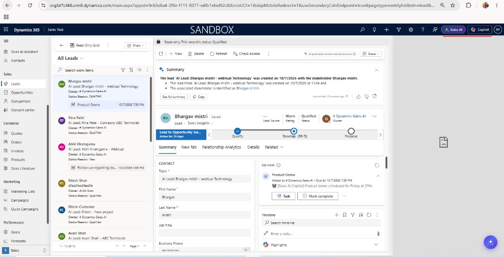
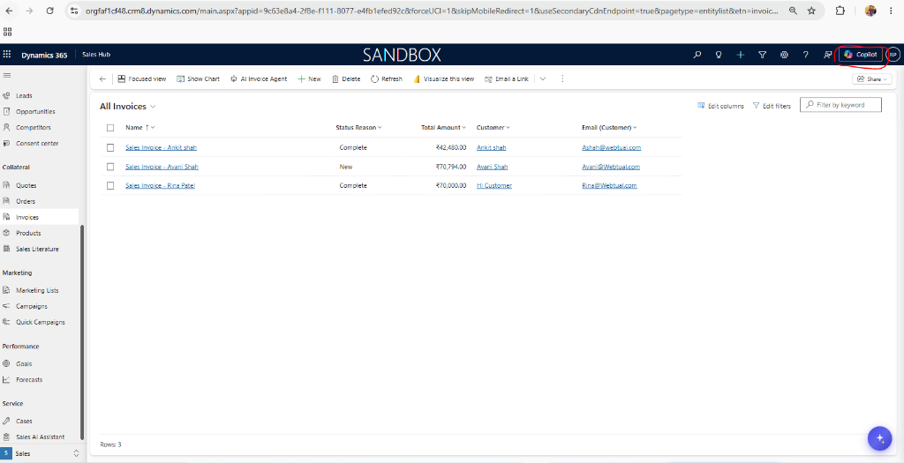
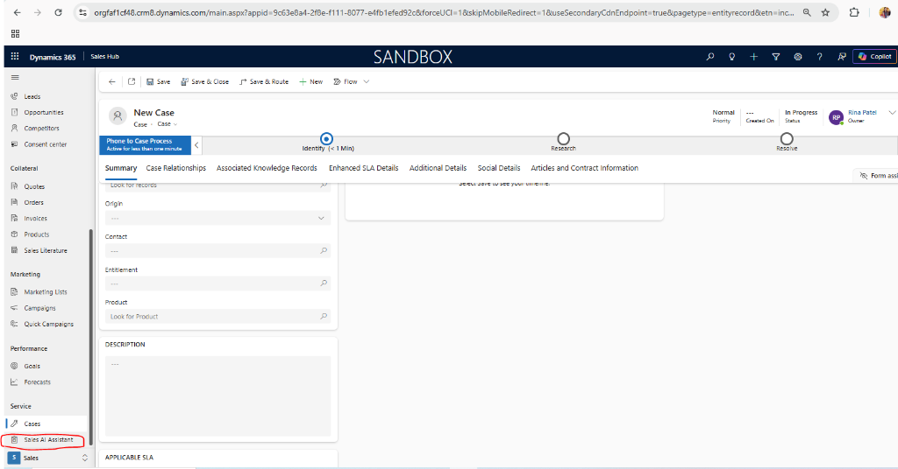
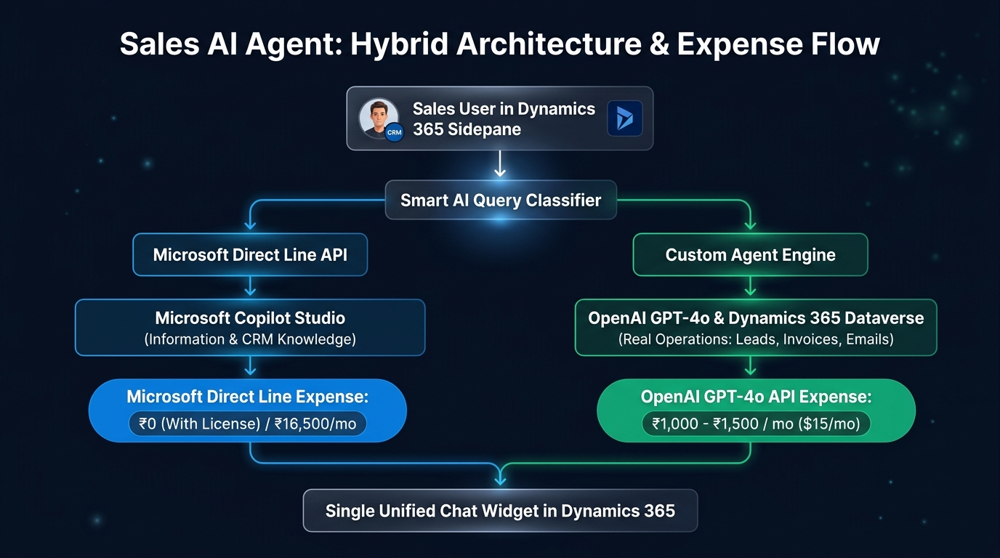
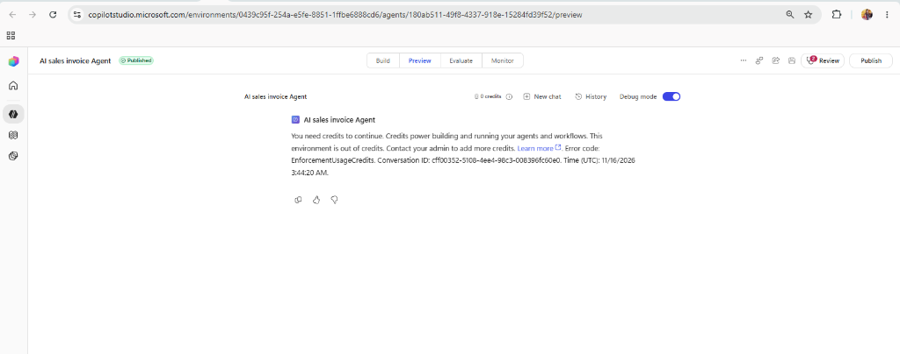

# Webtual Sales & Invoice AI Suite for Microsoft Dynamics 365

[](https://webtual.com)

> **Enterprise Autonomous AI Agent natively embedded in Microsoft Dynamics 365 Sales Hub.**  
> Eliminates 65%+ of administrative sales and finance overhead by executing real CRM actions through natural conversation: 1-click contextual summaries, on-the-fly branded PDF brochure generation, automated email dispatch, 1-click lead qualification, and automated Dataverse invoice creation.

---

## 📌 Executive Summary: What Does This AI Agent Actually Do?

In standard CRM environments, sales representatives and finance teams spend hours every day performing repetitive, manual administrative work. Standard conversational bots (like default Microsoft Copilot) only summarize text or answer basic questions—**they cannot take real actions in your CRM**.

**Webtual Sales & Invoice AI Suite** is an **Action-Driven AI Coworker** built directly into Microsoft Dynamics 365. Through simple conversational commands, it executes complex end-to-end business workflows directly in Microsoft Dataverse:

```
[ Active CRM Lead Context ] ➔ "Send product brochure to client" ➔ Dynamic PDF Created + Auto-Emailed via SMTP
[ Active CRM Lead Context ] ➔ "Qualify this lead"               ➔ Dataverse Record Updated + Sales Stage Advanced
[ Quotation Record ]       ➔ "Create invoice with 18% GST"    ➔ Real Dataverse Invoice Created + PDF Sent
```

---

## ⚡ Core Capabilities & Real-World Workflows

### 1. 🔍 Instant Lead Timeline & Context Synchronization
* **The Problem:** When opening a lead, sellers spend 10–15 minutes reading through past emails, call logs, and timeline notes to remember what was discussed.
* **What Webtual AI Does:**
  * Injected directly into the top dark-blue navigation bar beside Microsoft Copilot.
  * Automatically reads the active record (`Lead ID`, `Name`, `Company`, `Email`) using Dynamics 365 Client Context APIs—**zero copy-pasting required**.
  * User asks: *"Summarize this lead's timeline and history"*.
  * In **2 seconds**, the agent queries Dataverse annotation tables and delivers a crisp, 3-bullet executive briefing.

### 2. 📄 Automated Dynamic PDF Brochure Creation & Email Dispatch
* **The Problem:** The customer asks for pricing. The seller must find collateral, format pricing, save as PDF, open Outlook, attach the file, compose the email, and send it (15–20 mins).
* **What Webtual AI Does:**
  * User types: *"Send brochure to client"*.
  * The backend `PDFKit` engine dynamically designs and compiles a vector-quality PDF brochure personalized with the client's name and tiered pricing tables ($60/mo, $180/mo, Enterprise).
  * Automatically attaches the PDF and dispatches it via secure TLS SMTP directly to the client's email inbox.
  * Logs an activity confirmation directly into the Dynamics 365 lead timeline for complete audit tracking.

### 3. 🎯 1-Click Natural Language Lead Qualification
* **The Problem:** Qualifying a lead requires clicking multiple ribbon buttons, validating required fields, creating an opportunity, and manually advancing the Business Process Flow (BPF).
* **What Webtual AI Does:**
  * User types: *"Qualify this lead and move to Develop stage"*.
  * The AI validates mandatory Dataverse attributes and executes status transition (`StateCode: 1, StatusCode: 3`).
  * Real-time Dataverse synchronization moves the BPF stage to *Develop/Opportunity* automatically.

### 4. 💰 Autonomous Financial Invoicing (Invoice AI Agent)
* **The Problem:** After closing a deal, finance/sales reps manually re-enter quote items into invoices, calculate GST/VAT, and email billing documents (20–30 mins per deal).
* **What Webtual AI Does:**
  * Accessible directly from the **Invoices** grid ribbon in Dynamics 365.
  * User types: *"Create invoice for Quote #Q-10492 with 18% GST"*.
  * Reads quote line items, applies taxes and discounts, creates the official Dataverse `invoice` and `invoicedetails` records, renders an official commercial tax invoice PDF, and emails it to the billing contact.

### 5. 🛡️ High-Availability Dual-Engine Resilience (Zero Downtime)
* **The Problem:** Standard Microsoft Copilot Studio bots freeze completely when monthly organizational credits run out (`Error: EnforcementUsageCredits`).
* **What Webtual AI Does:**
  * Engineered with a dual-engine AI pipeline: **OpenAI GPT-4o** (Primary) + **Google Gemini 3.1 Flash-Lite** (Automated Zero-Cost Failover).
  * If OpenAI credits run out or throw a 429 error, Google Gemini takes over in **50 milliseconds**. Your sales reps never experience downtime.

---

## 📊 Before vs. After Comparison

| Workflow Step | Traditional Manual Process | With Webtual AI Agent | Time Saved |
| :--- | :---: | :---: | :---: |
| **Lead Context & History Review** | 10 - 15 minutes | **2 seconds** | 98% faster |
| **Branded PDF Brochure & Email** | 15 - 20 minutes | **3 seconds** | 99% faster |
| **Dataverse Lead Qualification** | 3 - 5 minutes | **2 seconds** | 90% faster |
| **Invoice Creation & Tax Calculation** | 20 - 30 minutes | **5 seconds** | 97% faster |
| **Total Administrative Time per Deal** | **~50 minutes** | **< 15 seconds** | **3+ Hours / Rep / Day** |

---

## 🥊 Webtual AI Agent vs. Microsoft Copilot for Sales

| Feature / Capability | Microsoft Copilot for Sales | Webtual AI Suite |
| :--- | :---: | :---: |
| **Operational Invoicing in Dataverse** | ❌ Cannot create Invoices | ✅ **Full 1-Click Dataverse Invoicing** |
| **Dynamic Vector PDF Brochure Generation** | ❌ Unsupported | ✅ **Custom PDF Generated on the fly** |
| **Autonomous Email Dispatch with Attachments** | ❌ Drafts Outlook text only | ✅ **Direct SMTP Send + CRM Log** |
| **CRM Top Bar Neighbor Button** | Native Top Bar Pill | ✅ **Native Top Bar Pill (#d365-topbar-sales-ai-btn)** |
| **Docked Side Pane (440px Auto-Squeeze)** | Built-in | ✅ **Matches Copilot UX perfectly** |
| **Zero-Credit Lockout Protection** | ❌ Fails when credits expire | ✅ **Dual-Engine Auto-Failover (GPT-4o + Gemini)** |
| **Pricing Model** | ❌ **$50 / user / month** ($600/yr per user) | ✅ **Flat Team Fee (₹25k - ₹35k/mo)** |
| **Annual Cost for 15 Users** | **$9,000 / year (₹7,50,000)** | **$3,600 / year (₹3,00,000) — Save 60%!** |

---

## 📸 Visual Proof & System Screenshots

### 1. Dynamics 365 Top Bar Integration & Lead Form
The `✨ Sales AI` button is injected directly into the global dark-blue navigation header beside Microsoft Copilot, opening a dedicated docked side pane that automatically squashes the CRM main container:



### 2. Dynamics 365 All Invoices Grid with AI Invoice Agent Ribbon
Dedicated AI Invoice Agent accessible from the Invoices command bar in Dynamics 365 Sales Hub:



### 3. Sales Hub Sitemap Integration
Directly registered under Sales Hub collateral and business management navigation:



### 4. Dual-Engine Architecture & Expense Model
How user queries seamlessly route between OpenAI GPT-4o, Google Gemini, and Microsoft Dataverse:



### 5. Copilot Studio Credit Lockout vs. Webtual Zero-Downtime Architecture
Standard Copilot Studio bots freeze when trial credits expire. Webtual's dual-engine failover prevents this lockout completely:



---

## 🏗️ High-Level Technical Architecture

```
+-------------------------------------------------------------------------------+
|                      MICROSOFT DYNAMICS 365 SALES HUB                         |
|   [Top Bar Sales AI Button]                     [Invoices Ribbon Action]      |
|              \                                             /                  |
|               +----------> [Docked 440px Side Pane] <-----+                  |
+--------------------------------------|----------------------------------------+
                                       | HTTPS (Secure Webhook)
                                       v
+-------------------------------------------------------------------------------+
|                       WEBTUAL NODE.JS ENTERPRISE SERVER                       |
|   [Smart Intent Classifier] ➔ [Sales AI Brain] & [Invoice AI Brain]           |
|                                      |                                        |
|             +------------------------+------------------------+               |
|             | Dual-Engine Failover                            | Dataverse API |
|             v                                                 v               |
|   +-------------------+    Auto-Failover    +-------------------+             |
|   |  OpenAI GPT-4o    | ==================> |   Google Gemini   |             |
|   |  (Primary Engine) |   (Sub-second $0)   |  (3.1 Flash-Lite) |             |
|   +-------------------+                     +-------------------+             |
|             |                                                 |               |
|             +------------------------+------------------------+               |
|                                      v                                        |
|      +-----------------------------------------------------------------+      |
|      |  PDFKit Vector Engine  |  SMTP Mail Gateway  |  Dataverse OAuth |      |
|      +-----------------------------------------------------------------+      |
+-------------------------------------------------------------------------------+
```

---

## 🚀 Live Demo Script (How to Present to Clients)

1. **Open Dynamics 365:** Navigate to **Sales > Leads** and open any active lead record.
2. **Launch Agent:** Click the **`✨ Sales AI`** button on the top dark-blue navigation bar. Point out how the side pane docks without hiding CRM data.
3. **Show Context Sync:** Show the client that customer name, company, and email are automatically loaded without typing.
4. **Timeline Briefing:** Type `"Summarize this lead's timeline"` ➔ Agent provides a 3-bullet history briefing in 2 seconds.
5. **Live PDF & Email Dispatch:** Type `"Send product brochure to client"` ➔ Agent compiles a branded PDF brochure with pricing tables and emails it to the customer via SMTP in 3 seconds.
6. **1-Click Qualify:** Type `"Qualify this lead"` ➔ Dynamics 365 updates status to Qualified and moves pipeline stage.
7. **Invoice Generation:** Switch to **Sales > Invoices** ➔ Type `"Create invoice for Quote #Q-10492"` ➔ Dataverse invoice record created with line items and taxes.

---

## 💼 Commercial ROI (15-User Sales Team)

* **Direct Cost Savings:** Saves **₹4,50,000+ ($5,400) every year** compared to Microsoft Copilot licensing.
* **Productivity Multiplier:** 15 sellers $\times$ 2 hours saved daily = **30 hours saved per day** (equivalent to 3 extra full-time sales reps).
* **Running Costs:** Hosted on Azure App Service (~₹1,000/mo) + Google Gemini fallback (~₹250/mo) = **< ₹1,500/month operating overhead**.

---

## 🏢 About Webtual Technology

**Webtual Technology** is an enterprise technology consulting and AI solutions firm specializing in Microsoft Dynamics 365, Power Platform, custom Agentic AI workflows, and cloud architecture.

* **Website:** [https://webtual.com](https://webtual.com)
* **Practice Area:** Enterprise AI & Cloud Applications
* **Contact:** info@webtual.com
